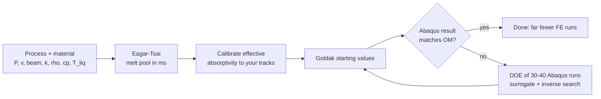

# Eagar-Tsai-Meltpool-Calibrator-App
Fast Eagar–Tsai melt pool calculator (Streamlit) for LPBF and laser welding: calibrate to your measured tracks, get Goldak heat-source starting values, and cut the number of Abaqus runs with DOE + surrogate.

# E-T Melt Pool Modeler

**A fast Eagar–Tsai melt pool calculator for laser powder bed fusion (LPBF) and laser welding, with calibration to your own measured melt pools, Goldak heat-source starting values, and tools that cut the number of heavy FE (Abaqus) runs you need.**

One Python file, one Streamlit app, any material, no real-alloy data built in.

  

---

## Table of contents

1. [The problem and why this exists](#1-the-problem-and-why-this-exists)
2. [What the app does](#2-what-the-app-does)
3. [Quick start](#3-quick-start)
4. [The physics in five minutes](#4-the-physics-in-five-minutes)
5. [Tab-by-tab guide](#5-tab-by-tab-guide)
6. [Typical workflows](#6-typical-workflows)
7. [Input file formats](#7-input-file-formats)
8. [Outputs](#8-outputs)
9. [Limits: when not to trust it](#9-limits-when-not-to-trust-it)
10. [Testing and validation status](#10-testing-and-validation-status)
11. [Project layout and data folder](#11-project-layout-and-data-folder)
12. [References](#12-references)
13. [License, citation, contributing](#13-license-citation-contributing)

---

## 1. The problem and why this exists

Predicting what an LPBF part looks like (melt pool size, solidification conditions, microstructure) usually means a **transient thermal FE model** (e.g. Abaqus with a moving Goldak heat source). That has two costs:

* **Each FE run is heavy** (minutes to hours), and a heat source has several unknowns: absorbed fraction, and the three ellipsoid semi-axes. Tuning them against micrographs by trial and error means **dozens or hundreds of runs**.
* The alternative, **print → section → polish → image**, is slow, expensive and destructive.

Most of that trial and error is wasted, because a good first guess is available **analytically**. The Eagar–Tsai (E-T) model gives the melt pool of a moving Gaussian laser spot in **milliseconds**. It is not exact, but it is good enough to:

1. estimate melt pool width, depth and length before you simulate anything,
2. calibrate the one number you do not know (an *effective* absorptivity) against a handful of measured tracks,
3. hand you **good starting values for the Goldak heat source**, and
4. when that is still not enough, design a **small set of Abaqus runs** (Latin-hypercube design of experiments) and fit a surrogate, instead of searching by hand.



---

## 2. What the app does

| Capability | Where |
|---|---|
| Melt pool **width, depth, length** (head and tail), peak temperature, thermal gradient and cooling rate at the trailing liquidus point (E-T estimates), linear/volumetric energy density, normalized enthalpy, regime flag | Results |
| Any material: you enter k, ρ, cp, liquidus (and optionally solidus, boiling point, latent heat) **with a source for every value** | Material |
| **Temperature-dependent property tables** (Abaqus-style) turned into effective constants (integrated between T0 and the liquidus, with latent heat) | Material |
| **Calibration** of an effective absorptivity (optionally beam size and conductivity scale) with standard errors, correlations, hold-out and leave-one-out validation, optional emcee posterior | Calibration |
| Power–speed **process maps** and a **process window** (lack of fusion, keyhole limit) | Sweep / maps |
| **Goldak double-ellipsoid** starting values in two naming conventions | Goldak export |
| **Hybrid depth** model for deep, keyhole-like tracks where E-T fails | Hybrid depth |
| **Profile calibration**: fit to the whole digitised melt pool outline (cross-section + optional longitudinal section) | Profile calibration |
| **FE-informed correction** of E-T and **Goldak surrogate** with design of experiments and inverse search | FE correction / Goldak surrogate |
| One **formatted Excel report** with everything, PNG figures (300 dpi), optional DOCX report, session save/restore | Sidebar, Results |

Design principles: one tab per input group, every number in SI internally (temperatures in K), plain-language explanations next to every result, and honest warnings instead of silent extrapolation.

---

## 3. Quick start

### Requirements

* Python **3.10+** (developed and tested on 3.12)
* Required packages: `numpy`, `scipy` (≥ 1.8), `pandas`, `matplotlib`, `openpyxl`, `streamlit` (a recent version; developed on 1.66)
* Optional: `python-docx` (DOCX report), `emcee` (Bayesian posterior in the Calibration tab), `eagar-tsai` (independent cross-check of the engine)

### Install and run

```bash
git clone https://github.com/<your-user>/<your-repo>.git
cd <your-repo>

python -m venv .venv
# Windows: .venv\Scripts\activate      macOS/Linux: source .venv/bin/activate

pip install numpy scipy pandas matplotlib openpyxl streamlit
pip install python-docx emcee eagar-tsai        # optional

python -m streamlit run et_modeler.py
```

The app opens in your browser at `http://localhost:8501`.

### Check the installation

```bash
python et_modeler.py --selftest     # engine, calibration and module tests (about 1.5 minutes)
python et_modeler.py --uitest       # headless tests of the whole interface (several minutes)
```

Every line should say `PASS`.

### Troubleshooting

| Symptom | Fix |
|---|---|
| `ImportError: pyarrow requires NumPy 2.0 or newer, found 1.26...` | Mismatched packages. Run `python -m pip install --upgrade numpy pandas scipy matplotlib pyarrow streamlit openpyxl` in the same environment and restart. The app also shows this fix on screen. |
| Saving a material or profile fails | The app writes to an `et_data/` folder next to the script. If that folder is not writable (for example inside `C:\Program Files`), it falls back to `~/.et_modeler`. Better: keep the script in a normal user folder. |
| Optional features missing | Install the optional packages above. The app works without them and says so in the relevant tab. |

---

## 4. The physics in five minutes

### The Eagar–Tsai model

Eagar and Tsai (1983) solved heat conduction for a **Gaussian surface heat source moving at constant speed over a semi-infinite solid** with constant properties. In the frame of the beam (x < 0 is behind it, z ≥ 0 goes into the part), the temperature rise is

$$
T-T_0=\frac{q\sqrt{\alpha}}{2\pi^{3/2}k}\;2\int_0^\infty\frac{ds}{\sigma^2+2\alpha s^2}\,
\exp\!\left(-\frac{z^2}{4\alpha s^2}-\frac{(x+vs^2)^2+y^2}{2(\sigma^2+2\alpha s^2)}\right)
$$

with absorbed power $q=\eta P$, beam standard deviation $\sigma$, speed $v$, conductivity $k$, diffusivity $\alpha=k/(\rho c_p)$ and $t=s^2$.

The **melt pool is the region where T exceeds the liquidus**:

* **width** = widest extent at the surface (z = 0), maximised over x,
* **depth** = deepest extent on the centreline (y = 0), maximised over x,
* **length** = extent along the surface centreline (head ahead of, tail behind, the beam centre).

### Beam definitions

The beam is entered as you find it on a data sheet and converted to σ: **σ = D/4** for a D4σ or 1/e² *diameter*, **σ = w/2** for a 1/e² *radius*.

### Numerics

The integral is evaluated with composite Gauss–Legendre quadrature on geometrically spaced panels (default 48 panels × 8 nodes plus 8 sub-panels near s = 0, which resolve points just below the surface). Width and depth come from vectorised bisection on the liquidus isotherm. Typical cost: about **0.04 s per case**, a 9 × 9 power–speed sweep in about **3 s**.

### What E-T leaves out (on purpose)

Latent heat, convection, radiation, Marangoni flow, evaporation, powder-bed effects and temperature-dependent properties. That is why it is fast, and why it is only valid in **conduction mode**. See [Limits](#9-limits-when-not-to-trust-it).

---

## 5. Tab-by-tab guide

Every tab starts with a colored banner and a **"How to use this tab"** box (why you need it, steps, good to know). The sidebar offers **session save/restore** (JSON) and the **full Excel report**.

### 1 · Process
*Describes the laser pass.*
* **Laser power** (W or kW), **scan speed** (mm/s or m/s), **beam size** (µm, mm, m) with its **definition** (D4σ diameter, 1/e² diameter, 1/e² radius).
* **Absorptivity η (effective)**: the fraction of laser power that heats the metal in the model. If unknown, start around 0.3–0.5 and calibrate (tab 6).
* **T0**: substrate or preheat temperature in K.
* Expander: **layer thickness** and **hatch spacing** (used for energy density and the process window) and the **beam-size scale factor** (filled by calibration).

### 2 · Material
*Thermal properties of **your** metal. Nothing is built in.*
* k, ρ, cp, liquidus, and optionally solidus, boiling temperature and latent heat. **Each value has its own source box**, and the app warns if a source is missing or still says *VERIFY*. Save materials for later sessions.
* **Temperature-dependent table** (Abaqus-style): one row per temperature, columns for temperature, conductivity, density, specific heat, optional enthalpy and optional liquid fraction. Paste cells from Excel or load a CSV/XLSX (JMatPro-style headers are recognised).
  * The app **integrates** the interpolated curves between T0 and the liquidus (not a row average, so uneven spacing is handled correctly) and uses the mean of ρ·cp as the energy per volume. Alternatively use the value at a reference temperature.
  * **Latent heat** is a single number (J/kg): tick the box to add L/(T_liq − T0) to cp, or supply an enthalpy column that already contains it. An enthalpy-based cp and the liquid-fraction column (which gives solidus and liquidus) are supported.
  * Warnings catch the common mistakes: a table that looks like °C but is set to K, or missing latent heat (typically 10 % too large a pool).
  * Plots of every curve with the averaging window and the effective value, and an **Apply** button that fills the constants above.

### 3 · Model settings
*Numerical accuracy and warning thresholds.*
* Quadrature panels and x-samples (defaults are accurate to about 1e-6 for normal cases; change only to test convergence), conductivity scale factor (from calibration).
* **Depth/width thresholds** for "transition" and "keyhole-suspect", an optional normalized-enthalpy flag. These are **editable rules of thumb**, not laws.
* **Cross-check button**: compares the engine with the independent `eagar-tsai` library on a small domain (tolerance max(2.5 µm, 3 %)).

### 4 · Experimental data
*Your measured single tracks.*
* Upload a CSV/XLSX or **paste** from Excel, map the columns, pick the units, press **Load into table**. A blank template is available for download.
* Edit rows in place; tick **exclude** to ignore a track (blank = keep).
* Optional **overlay**: type one measured width/depth to draw it on the Results plots and to solve for the matching absorptivity.

### 5 · Results
*The prediction for the current inputs.*
* A **regime** message (conduction / transition / keyhole-suspect, plus boiling and extreme-temperature warnings).
* A table with **units and a plain-language meaning for every number**: width, depth, length (head and tail), length/width, depth/width, peak temperature, thermal gradient and cooling rate at the trailing liquidus point (E-T estimates), P/v, volumetric energy density, normalized enthalpy.
* Figures: cross-section, top view, longitudinal section, surface temperature heatmap; optional **sensitivity** (±10 % of each input).
* **Absorptivity solver**: with a measured width entered in tab 4, shows the η that reproduces it, with a one-click apply.
* Shows the **hybrid depth** once tab 9 is calibrated.
* Downloads: PNG figures (300 dpi), the full Excel report, optional DOCX.

### 6 · Calibration
*Fit the uncertain inputs to your measured tracks.*
* Default: fit **absorptivity only**. Optional: beam-size scale and conductivity scale. Weights per width/depth/length, optional exclusion of tracks above a depth/width cut-off (keyhole tracks).
* Least squares on **relative errors**; **standard errors and correlations** from the Jacobian; warnings when |r| > 0.9 or a standard error exceeds 25 % of the value.
* **Validation**: random 30 % hold-out or leave-one-out with a progress bar. Parity and residual plots.
* **Apply** to the other tabs; save and load calibration profiles; optional **emcee** posterior.
* The fitted η is an **effective fitting parameter**, never a measured absorptivity, and it does not transfer between alloys.

### 7 · Sweep / maps
*Process-window overview.*
* Power–speed grid (up to 40 × 40), colored by depth, width, length or depth/width.
* **Process-window overlay**: lack of fusion when (H/w)² + (L/d)² > 1 (H = hatch spacing, L = layer thickness; choose the Process-tab layer or a custom value) and a keyhole limit w/d > 1.5 (editable). Use E-T depth or the hybrid depth: E-T alone cannot show keyhole risk.

### 8 · Goldak export
*Starting values for a Goldak double-ellipsoid heat source.*
* a, b, c_f, c_r, f_f, f_r and Q = ηP, in two naming conventions (Goldak 1984; common AM-FEM naming), each with its meaning.
* **Caveat shown in the app**: Goldak semi-axes are 5 %-density radii, not melt pool dimensions, so calibrated values are usually *larger* than these starting guesses. Tab 11 shows how to calibrate them with few runs.

### 9 · Hybrid depth
*For deep, keyhole-like tracks.* E-T cannot give a depth much above half the width. The tab unlocks when some measured depth/width exceeds 0.5 and fits

$$
R=\frac{d}{w}=\frac{A\,P}{2\,a\,k\,(T_b-T_0)\,g(Pe)},\quad a=\text{1/e}^2\text{ radius},\; Pe=\frac{v\,a}{D},\; D=\frac{k}{\rho c_p}
$$

with a cubic $g(Pe)$ whose coefficients are fitted by **linear least squares** from your data (at least 8 tracks and the boiling temperature are required). Width stays the E-T width; depth = R × width. Pe is clamped to the calibrated range with a warning; the tab reports R² and the leave-one-out depth error versus plain E-T. The regime is set by R (conduction < 0.8, transition 0.8–1.2, keyhole > 1.2, all editable).

### 10 · Profile calibration
*Fit to the whole melt pool outline instead of two numbers.*
* Input per track: power, speed, a digitised half cross-section outline (y across, z down, origin on the track centreline at the surface) and, strongly recommended, a **longitudinal outline**.
* The simulated outline is the **envelope over x** of the liquidus isotherm (widest/deepest section along the track), found by bisection along 61 rays, not a single cross-section.
* Distance **D** = RMS radial difference between measured and simulated outline divided by the measured depth (total D = √(D_CS² + D_MF²)). η (and optionally beam scale) is fitted on D, with standard errors and an overlay plot.
* **Identifiability warning**: cross-sections alone do not constrain the scan-direction extent. The E-T length is shown only as a labelled *prior*. A demo button generates synthetic outlines with a known η so you can see the recovery work.

### 11 · FE correction / Goldak surrogate
*Fewer Abaqus runs.*
* **6a, discrepancy model**: paste 10–25 Abaqus results computed with one fixed Goldak set over a power–speed grid. The app fits `y_FE = y_ET · (1 + c0 + c1·P_norm + c2·v_norm)` per output (ridge least squares), reports the leave-one-out error versus raw E-T, and **refuses to extrapolate** outside your Abaqus range.
* **6b, inverse calibration**: set ranges for Goldak a, b, c and η, generate a **Latin-hypercube** list of 30–40 runs, run them in Abaqus and paste the width/depth/length back. The app fits an RBF or quadratic-ridge **surrogate** (leave-one-out error reported) and uses **differential evolution** to find parameters that reproduce your measured values, returning the best set plus alternatives to verify in Abaqus. It warns when targets lie outside the DOE range or when there are fewer targets than free parameters (fix η by giving it equal low and high).

### 12 · Assumptions
A complete list of what the model assumes, how flags are defined, how calibration works and what the advanced modules assume.

### 13 · References
Sources of the equations, methods and defaults, **with how each was checked** (see below), plus where every default number comes from.

---

## 6. Typical workflows

**A. Quick estimate (2 minutes).** Process → Material (type values and sources) → Results. Read the regime message first.

**B. Calibrate to your micrographs.** Material → Experimental data (5 or more tracks with width and depth) → Calibration (absorptivity only) → check parity, residuals and leave-one-out → Apply → Goldak export.

**C. Deep or keyhole-like tracks.** After B, add keyhole tracks to the table, enter the boiling temperature, and fit tab 9. The process window (tab 7) can then use the hybrid depth.

**D. Heat source for FE.** Take the Goldak starting values, run Abaqus, compare with your sections. If they disagree: tab 11, 6a (cheap correction) or 6b (design of experiments + surrogate + inverse search).

---

## 7. Input file formats

* **Experimental tracks** (CSV, XLSX or pasted): one row per track; required **power** and **speed**; give **width** and/or **depth** (length optional); optional **beam size** per track and an **exclude** flag (`x`, `yes`, `true`, `1`; blank = keep). Header names are free: you map them in the app. Units are chosen in dropdowns (one per quantity for the whole file).
* **Property table**: columns `T`, conductivity, density, specific heat, optional enthalpy, optional liquid fraction (any subset). Temperature in K or °C (choose in the app).
* **Profile boundaries**: CSV with `track, y_um, z_um` (cross-section) and optionally `track, x_um, z_um` (longitudinal; x ahead of the beam centre positive, z down). The x origin of a longitudinal outline must be the beam position.
* **FE results (6a)**: `power_W, speed_m_s, width_um, depth_um, length_um`. **DOE results (6b)**: the generated table with width/depth/length (and optionally `D`) filled in.

---

## 8. Outputs

* **Full Excel report** (sidebar and several tabs): Summary (colored regime), Inputs, Goldak, and, when you have run them, Calibration, Sweep, Properties, Hybrid depth, Profile calibration, FE correction, Goldak inversion, Process window, plus Notes and References. Numbers are real numeric cells with units and a "what it means" column.
* **PNG figures** at 300 dpi: sections, heatmap, sensitivity, parity, residuals, property curves, hybrid parity, profile overlay, process window, posterior.
* **DOCX report** (needs `python-docx`), **session JSON**, saved materials and calibration profiles.
* All downloads are generated **only when you click** them and do not rerun the app.

---

## 9. Limits: when not to trust it

* **Conduction mode only.** E-T underpredicts keyhole depth. In keyhole conditions use the hybrid depth model or FE.
* **Peak temperatures are unrealistic** at high power or small beams (no evaporation). A peak far above the boiling point means the case is outside the model's validity; width and depth, which depend on the liquidus isotherm, are much less affected.
* **Constant properties.** Temperature-dependent tables are averaged; the average between T0 and the liquidus is a modelling choice, not an exact equivalent.
* **The calibrated absorptivity is effective.** It absorbs powder-bed effects, property errors, beam errors and model error. Do not report it as a measured absorptivity and do not transfer it to another alloy or machine.
* Gradient and cooling rate are **E-T estimates** at the trailing liquidus point, not FE results.
* Flags and thresholds (depth/width 0.5 and 1.0, normalized enthalpy 6, peak T above 20 × liquidus) are **rules of thumb**, editable in the app.
* Goldak values are **starting guesses**, not calibrated parameters.
* A calibration based on very few tracks is poorly constrained: the app warns, but it cannot invent information.

---

## 10. Testing and validation status

`python et_modeler.py --selftest` runs 21 checks, including:

* the **Rosenthal limit** (relative error < 1e-3),
* the quadrature against `scipy.integrate.quad` on **300+ random points** spanning α 6e-7–5e-5 m²/s, v 0.05–3 m/s, σ 8–80 µm (relative error < 1e-4),
* symmetry, linearity in power, trends in power and speed, E-T depth/width ≤ 0.51 over a wide sweep,
* a cross-check against the independent `eagar-tsai` library (if installed),
* speed targets (< 0.1 s per case, 9 × 9 sweep < 10 s),
* synthetic calibration recovery, file reading with unit conversion and blank exclude cells,
* temperature-table parsing, effective properties, latent heat lowering the width,
* hybrid depth: cubic g(Pe) recovered from exact synthetic data, leave-one-out, clamping,
* profile metric (circle gives constant r(φ), identical profiles give D = 0), envelope against the direct geometry, recovery of a known η from cross-section + longitudinal outlines,
* FE correction, Latin-hypercube stratification, surrogate leave-one-out and differential-evolution recovery of known parameters, process-window criteria, the Excel workbook.

`python et_modeler.py --uitest` drives the full interface headlessly (17 scenarios: invalid inputs, no-melt case, unit switch, session restore, calibration flow, each new tab).

**What is not validated:** this repository does not validate the model against experiments. Hybrid depth, profile calibration, FE correction and the Goldak surrogate follow a written method description; the benchmark numbers quoted in the app (for example 13 % versus 1.5 % error on the scan-direction axis) were taken from that description and were not independently re-derived. Check them against the original papers before relying on them.

---

## 11. Project layout and data folder

```
et_modeler.py     the whole application (engine, calibration, modules, UI, self-tests)
README.md         this file
et_data/          created on first save: saved materials and calibration profiles
                  (falls back to ~/.et_modeler if the folder is not writable)
```

Internally the file is organised as: constants and units → materials → E-T engine and geometry → calibration → sweeps and sensitivity → plots → export → advanced modules → Streamlit UI → command-line tests.

---

## 12. References

The app contains the same list in tab 13 with a "how it was checked" column. Verification status as of this README: the *eagar-tsai library* and *King et al. 2014* were checked online; everything marked *from memory* should be confirmed (authors, volume, pages) before you cite it.

* T. W. Eagar, N.-S. Tsai, *Temperature fields produced by traveling distributed heat sources*, Welding Journal 62(12), 346s–355s (1983).
* D. Rosenthal, *The theory of moving sources of heat and its application to metal treatments*, Trans. ASME 68, 849–866 (1946). *(from memory)*
* H. S. Carslaw, J. C. Jaeger, *Conduction of Heat in Solids*, 2nd ed., Oxford University Press (1959). *(from memory)*
* J. Goldak, A. Chakravarti, M. Bibby, *A new finite element model for welding heat sources*, Metall. Trans. B 15(2), 299–305 (1984). *(from memory)*
* W. E. King et al., *Observation of keyhole-mode laser melting in laser powder-bed fusion additive manufacturing*, J. Mater. Process. Technol. 214(12), 2915–2925 (2014). *(existence and journal checked; pages from memory)*
* J. Trapp et al., *In situ absorptivity measurements of metallic powders during laser powder-bed fusion additive manufacturing*, Appl. Mater. Today 9, 341–349 (2017). *(from memory)*
* W. Kurz, D. J. Fisher, *Fundamentals of Solidification*, 4th ed., Trans Tech (1998). *(from memory)*
* T. DebRoy et al., *Additive manufacturing of metallic components – Process, structure and properties*, Prog. Mater. Sci. 92, 112–224 (2018). *(from memory)*
* ISO 11146-1:2005, *Lasers and laser-related equipment: test methods for laser beam widths, divergence angles and beam propagation ratios, Part 1*. *(from memory)*
* P. Virtanen et al., *SciPy 1.0*, Nature Methods 17, 261–272 (2020); M. A. Branch, T. F. Coleman, Y. Li, SIAM J. Sci. Comput. 21(1), 1–23 (1999); R. Storn, K. Price, J. Global Optim. 11, 341–359 (1997); D. Foreman-Mackey et al., *emcee*, PASP 125, 306–312 (2013). *(from memory)*
* `eagar-tsai` Python library, ArroyaveLab, <https://github.com/ArroyaveLab/eagar-tsai> (GPL-3.0; used only as an optional cross-check and **not** bundled).
* Method descriptions supplied for tabs 9–11 (named there: *Hu et al. 2024* profile-distance metric; hybrid depth relation; Goldak 5 %-density-radius caveat; process-window criteria): **original sources not verified.**
* Dassault Systèmes, *Abaqus Analysis User's Guide* (material data blocks and DFLUX).

Material data (for example from JMatPro, DSC or CALPHAD) are **not** included: you supply your own and record the source.

---

## 13. License, citation, contributing

* **License:** choose one before publishing (MIT is a common choice for a single-file tool). The optional `eagar-tsai` library is GPL-3.0 and is only imported if the user installs it.
* **Citing:** if this tool helps your work, please cite the original Eagar–Tsai paper first, and this repository second:

  ```
  <Your Name>. E-T Melt Pool Modeler (software), <year>. https://github.com/<your-user>/<your-repo>
  ```
* **Contributing:** issues and pull requests are welcome. Please run `python et_modeler.py --selftest` and `--uitest` before submitting, and add a test for any new feature. If you find a case where a result disagrees with an independent calculation, please open an issue with the inputs.
